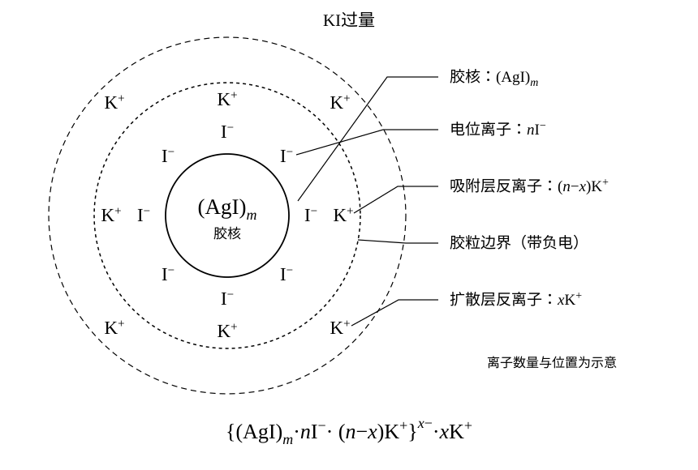

# 无机化学

## 第一章 分散系

### 分散系

**定义：一种或多种物质分散在另一种物质中所构成的系统称为分散系，其中被分散的物质称为分散质，分散其它物质的物质称为分散剂。**

按照分散质粒子大小可以对分散系进行分类：

| 项目 | 均相掺和物 | 高分子溶液 | 溶胶 | 粗分散系 |
| :--: | :--: | :--: | :--: | :--: |
| 粒子直径 | <1nm | 1 ~100mm | 1~100mm | >100nm |
| 系统的相 | 单相系统 | 单相系统 | 多相系统 |  多相系统 |
| 滤过情况 | 能通过半透膜 | 能透过滤纸，不能透过半透膜 | 能透过滤纸，不能透过半透膜 | 不能透过紧密滤纸 |

 

### 气体

理想气体的条件：
1. 分子无体积
2. 分子无分子间作用力

**高温、低压**的气体可以满足上述条件，气体间分子相互远离，创建了作用力小的条件，同时气体分子体积远小于气体体积，可以忽略不计。

理想气体状态方程：

$$pV=nRT$$

其中，$R=8.3145\text{J} · \text{mol}^{-1} · \text{K}^{-1} = 8.3145\text{Kpa} · \text{L} · \text{mol}^{-1} · \text{K}^{-1}$，在计算时一定要带上单位，不然会死。

::: question 例题 类型=解答题
某碳氢化合物碳原子和氢原子数相等，在 $100^\circ\mathrm{C}$，$101.325\text{Kpa}$ 条件下，测得密度 $\rho = 2.55\text{g}·\text{L}^{-1}$ ，确定该化合物的分子式。
:::

由理想气体状态方程得：

$$pV=nRT \tag{*}$$

有密度公式得 $\rho = \frac{m}{V}$，考虑到该物质的碳氢分子相等，设为 $(\text{CH})_x$，只需确认分子的相对分子质量即可。因此考虑将物质的量 $n$ 换为定义式 $n=\frac{m}{M}$，将上述两式代入理想气体状态方程(*)式得：

$$
p \frac{m}{\rho} = \frac{m}{M} RT \implies pM = \rho RT
$$

代入数据计算得

$$
M = \frac{\rho RT}{p} = \frac{2.55\text{g}·\text{L}^{-1} × 8.3145\text{Kpa} · \text{L} · \text{mol}^{-1} · \text{K}^{-1} × 373.15\text{K}}{101.325\text{Kpa}} = 77.89\text{g}·\text{mol}^{-1}
$$

因此可以构建方程：

$$
x[m(\text{C}) + m(\text{H})] = [77.89]
$$

解得 $x=6$，即原化合物的分子式为 $\text{C}_6\text{H}_6$，也就是苯。

理想气体混合物的各组分可认为单独存在，也就是说，各组分产生的压力只与这一组分物质的量的占比有关，这被称为**Dalton分压定律**。这样说起来可能有些抽象，我们把它列成一个比例式。

$$
\frac{p_i}{p}=\frac{n_i}{n} \implies p_i = \frac{n_i}{n}p = x_i p 
$$

也就是说，理想气体混合物中某组分的气体分压等于该组分气体的摩尔分数（物质的量占比）与总压力的乘积。

::: question 例题 类型=解答题
在 $25^\circ\mathrm{C}, p =99.43 \text{kPa}$ 压力下,利用排水集气法收集氢气 $V=0.400 \text{L}$ 。计算在同样温度、压力下,用分子筛除去水分后所得干燥氢气的体积 $V(\text{H}_2)'$ 和氢气的物质的量 $n(\text{H}_2)$ 。已知 $25^\circ\mathrm{C}$ 时水的饱和蒸气压 $p(\text{H}_2\text{O})=3.17 \text{kPa}$。
:::

由**Dalton分压定律**，我们知道总压由各个分压构成，先计算氢气的分压：

$$p(\text{H}_2) = p - p(\text{H}_2\text{O}) = 99.43\text{kPa} - 3.17\text{kPa} = 96.26\text{kPa}$$

考虑气体过程：从氢气和水在一起到筛去水分只剩单独的氢气，氢气物质的量，常数 $R、T$ 的值显然都是不变的，因此理想气体状态方程左边    $pV$ 的乘积也不变，因此：

$$
pV(\text{H}_2)'=p(\text{H}_2)V
$$

这里可能理解有些困难，是这样，我们看的是对于氢气而言，前后两个状态。状态1：未干燥，氢气分压为 $p(\text{H}_2)$，总体积为已知的 $V$，状态2：已干燥，氢气分压为 $p$，因为这时候就是跟提给外界相等的压力了，而氢气体积为待求的 $V(\text{H}_2)'$。系统由状态1转换为状态2，理想气体状态方程右侧不变，因此使用左侧构建等式。这个式子非常容易写反，应该要注意我们关注的是系统内氢气的前后两个状态，而不是系统的前后两个状态。

计算得 
$$
V(\text{H}_2)' =  \frac{p(\text{H}_2)V}{p} = \frac{96.26 \text{kPa} × 0.400 \text{L}}{99.43\text{kPa}} = 0.387\text{L}
$$

那么 氢气的物质的量 $n(\text{H}_2)$ 显然可以由理想气体状态方程给出，不再赘述。

### 混合物的组成标度

一些不同的描述某一物质在溶液中占比的手段，大一初学无机化学时，这里确实没听懂，所以刚开始这一部分时我也感觉有点害怕，但是实际上真学起来也挺简单的。学这一块的关键就是不要死记硬背公式，要了解每一个量为什么要这么定义，如何推导这之间的转换关系。

**物质的量的浓度** $c_B$ 应该是我们的老朋友了，我们在高中时就一直在使用这个标度。这个标度表示的是一定体积（一升）的混合物中，到底含有多少的物质B，那么显然可以定义为B物质的量与溶液的体积之比。

$$c_B = \frac{n_B}{V}$$

但是用体积存在一个问题，还记得理想气体状态方程 $pV=nRT$ 吗？溶液的体积会随着温度变化，为解决这个问题，我们迫切的需要一个不随着温度而变化的量。很容易的，我们可以想到一个量：质量。质量不会随着温度而变化，因此我们定义**质量摩尔浓度** $b_B$ 为B的物质的量除以溶剂的质量，即：

$$b_B = \frac{n_B}{m_A}$$

这个量就不受温度影响了，但是需要注意下面的分母是溶液的质量而非混合物的总质量。那么上面两个量的关系到底是什么呢？如何才能从 $c_B$ 推导出 $b_B$？我们注意到，$b_B$ 与 $c_B$ 的差别就是，分母一个是体积，另一个是质量。有什么办法可以把体积和质量关联起来？对了，可以使用密度。我们使用密度公式换掉 $c_B$ 下面的体积，可以得到：

$$
c_B = \frac{n_B}{V} = \frac{n_B}{\frac{m}{\rho}} = \rho \frac{n_B}{m}
$$

这里出现了一个关键问题：$b_B$ 的分母是溶剂质量 $m_A$，而这里的分母是总质量是 $m$，但是如果溶液是稀溶液时，溶质的质量是溶剂面前可以忽略不计，认为 $m = m_A$。那么在稀溶液中，有：

$$c_B = \rho b_B $$

其中 $\rho$ 随温度而变化，因此 $c_B$ 满足随温度而变化的条件。上式当且仅当溶液是稀溶液时满足。更进一步的，如果溶液是稀的水溶液，可以认为密度接近于1，此时 $c_B = b_B$。

类比物质的量浓度，**质量浓度** $\rho_B$ 定义为B的质量与混合物的体积之比，即

$$
\rho_B = \frac{m_B}{V}
$$

上面我们定义所有量都是有点类似于密度的的量，很难直观的看出来某个物质在总组分中的占比。因此我们还需要一些能够直观的表示出占比的量。B物质的物质的量与混合物的物质的量之比，称为B的摩尔分数，即$x_B$。事实上，这个量我们前面已经偷偷的用过了一次，在道尔顿分压定律的时候，我们提到过，分压之比等于物质的量之比，某个物质的物质的量占比为：

$$x_i = \frac{n_B}{\sum n_i}$$

注意这里的分母是各个物质的物质的量之和，因为混合物没法算总体的物质的量，不要把混合物的各个组分的相对分子质量平均了之后拿总质量去除，这么做是没有任何道理的。

类比的，我们也可以定义质量分数，与上面的相同，B的质量分数 $w_B$ 为B的质量与混合物的质量之比，即为：

$$
w_B = \frac{m_B}{\sum m_i}
$$

这里分母写求和式或者直接写总质量都是可以的，因为这俩式子本质上并无任何不同。因为上面我们已经写了求和式，对称起见我们这里也用求和式了。

那么现在定义的新量跟前面的量又有什么样的换算关系呢？接下来我们就以一个常用的换算关系为例，假设溶质B的质量分数为$w_B$，密度为$\rho$（注意这里的$\rho$是密度而不是质量浓度），现在我们求出$c_B$。

从 $c_B$ 出发，分子是 $n_B$，分母是 $V$，质量分数显然跟质量有关，因此我们使用定义式分别将分子和分母打开，因为打开之后恰好出现了B的质量和总质量，然后发现 $w_B$ 自然而然的出现了，化简即可。这个公式是完全没必要背下来的，因为推理过程非常清晰。

$$
c_B = \frac{n_B}{V} = \frac{\frac{m_B}{M_B}}{V} =\frac{\frac{m_B}{M_B}}{\frac{m}{\rho}} = \frac{m_B \rho}{M_B m} = \frac{w_b \rho}{M_B}
$$

::: question 例题 类型=解答题
已知 $w(\text{H}_2\text{SO}_4)=96.0\%$ 的浓硫酸,密度 $\rho=1.84 \text{g·}\text{mL}^{-1}$。计算$c(\text{H}_2\text{SO}_4)$及$c(\frac{1}{2}\text{H}_2\text{SO}_4)$。
:::

这个换算我们刚刚推导过，上下两边同时拆开即可。

$$
c(\text{H}_2\text{SO}_4) = \frac{n(\text{H}_2\text{SO}_4)}{V} = \frac{w(\text{H}_2\text{SO}_4)\rho}{M(\text{H}_2\text{SO}_4)} = \frac{0.96×1.84\text{g·mL}^{-1}}{98\text{g·mol}^{-1}} = 18.0\text{mol·L}^{-1}
$$

不知道你注意到了吗，这里其实有个陷阱。上面的单位是 $\text{g·mL}^{-1}$，而我们最终得出的结果按照国际惯例应该是 $\text{mol·L}^{-1}$，因此我们需要将最终结果乘以 $10^3$ 把毫升换算成升。

接下来，$c(\frac{1}{2} \text{H}_2\text{SO}_4)$ 应该怎么处理呢？老实说，这玩意我也头一次见。事实上，这个 $\frac{1}{2} \text{H}_2\text{SO}_4$是基本单元的写法，不是真的有半个硫酸分子这种物质。在分析化学里，常常用等物质的量反应规则来定义基本单元。对于硫酸，如果基本单元取 $\text{H}_2\text{SO}_4$，那么它提供2个氢离子，而如果去$\frac{1}{2} \text{H}_2\text{SO}_4$，那么它提供1个氢离子。显见，要达到相同的浓度，半硫酸的浓度需要是硫酸的两倍，因此

$$
c(\frac{1}{2}\text{H}_2\text{SO}_4) = 2c(\text{H}_2\text{SO}_4) = 36.0 \text{mol·L}^{-1}
$$

::: question 例题 类型=解答题
计算 $w(\text{NaCl}) = 10\%$ 的氯化钠水溶液中溶质和溶剂的摩尔分数。
:::

根据定义式，先拆一下看看：

$$
w(\text{NaCl}) = 10\% \implies \frac{m(\text{NaCl})}{m(\text{H}_2\text{O})} = \frac{1}{9}
$$

既然要求的是摩尔分数，也就是说我们只需要求一个摩尔数比值，我们可能没要必要算出具体的数值来，前面我们已经求出了一个质量之比，那么为啥不求一下摩尔数之比呢？

$$
\frac{n(\text{NaCl})}{n(\text{H}_2\text{O})} = \frac{m(\text{NaCl})}{m(\text{H}_2\text{O})} × \frac{M(\text{H}_2\text{O})}{M(\text{NaCl})} = \frac{1 × 18}{9 × 58.5} = 0.034
$$

现在我们可以求摩尔分数了：

$$
x(\text{NaCl}) = \frac{n(\text{NaCl})}{n(\text{NaCl}) + n(\text{H}_2\text{O})} = \frac{0.034n(\text{H}_2\text{O})}{0.034n(\text{H}_2\text{O}) + n(\text{H}_2\text{O})} = 0.03
$$

作为一个占比而言，必然有各个组分的占比之和为1，因此

$$
x(\text{H}_2\text{O}) = 1 - x(\text{NaCl}) = 0.97
$$

### 稀溶液的依数性

一定温度下，液体与其蒸汽平衡时蒸汽的压力称为该温度下液体的**饱和蒸气压**，简称为**蒸气压**。这个概念非常重要，记不住后面的就看不懂了。

稀溶液中依数唯胜，相比于纯溶液，稀溶液存在一系列性质，包括蒸气压下降、凝固点降低、沸点上升等等，这些性质只与溶质的摩尔分数有关，而与溶质的本性无关，所以这一类性质称为**稀溶液的依数性**。注意，我们在这里讨论的溶液也都是难挥发的。

为什么稀溶液中蒸气压会下降呢？在纯溶液中，表层的所有分子都可以会发，而在稀溶液中，在表层的部分溶液分子变成了溶剂分子，由于是难挥发的，可以挥发的分子数量减少，因此挥发的量就减少，蒸汽就少，因此压力减小，进而饱和蒸气压减少。

饱和蒸气压到底减少了多少呢？在一定温度下，难挥发非电解质稀溶液的蒸气压等于纯溶剂的饱和蒸气压与溶液中溶剂摩尔分数的乘积，即**Raoult定律**。

$$
p = p^* x_A
$$

也就是说，只剩下了溶剂部分的蒸气压，对于两组分溶液，那么蒸气压的下降量 $\Delta p$ 显然由溶质部分给出。

$$
\Delta p = p^*(x_A+x_B) - p^*x_A = p^*x_B \tag{*}
$$

因此，**Raoult定律**还可以表示为，一定温度下，难挥发非电解质稀溶液的蒸气压下降与溶质的摩尔分数成正比。

在稀溶液中，溶质在量在溶质面前可以忽略不计，因此上式可以改写为 $\frac{n_\text{B}}{n_\text{A}}$。既然式子都变形成这样了，我会有一种把它改写为 $b_B$ 的冲动，因为太像了。我们在分子和分母上同乘一个 $M_A$，这时候分母就变成了 $m_A$，这是由摩尔量的定义式给出的。

$$
x_\text{B} = \frac{n_\text{B} M_\text{A}}{n_\text{A} M_\text{A}} = \frac{n_\text{B}}{n_\text{A} M_\text{A}}M_\text{A}=b_\text{B}M_\text{A}
$$

将上式代回(*)式，我们得到一个很有趣的结果：

$$
\Delta p = p^*x_\text{B} = p^* b_\text{B} M_\text{A}
$$

其中，$p^*$ 和 $M_\text{A}$ 在一定条件下是常数，设 $k=p^*M_\text{A}$，则 $\Delta p = kb_\text{B}$。因此，**Raoult定律**还可以表示为，一定温度下，难挥发非电解质的蒸气压下降与溶质的质量摩尔浓度成正比。我们为什么要大费周章的把 $b_\text{B}$ 放到这个式子里面呢？因为我们后面将会使用它构建米奇妙妙屋，且听后面分解吧。

液体的**沸点**是指液体的蒸气压等于外压时的温度。在稀溶液中，溶液的蒸发遇到困难，因此需要更高的温度才能蒸发到本来的标准，也就是说，稀溶液的沸点要上升。到底上升多少呢？这里有一个规律，**液体饱和蒸气压随温度在沸点附近近似线性变化**，又因为Raoult定律指出，**一定温度下，难挥发非电解质的蒸气压下降与溶质的质量摩尔浓度成正比**，因此：

$$
\Delta T_b \propto \Delta p \propto x_B \propto b_B
$$

正比关系导出了，接下来需要一个比例常数，不妨设 $K_b$ 为这个常数，这个参数只与溶剂有关，跟溶质无关，给它起个名叫溶剂的沸点升高常数，那么就可以写成下面的形式。

$$
\Delta T_b = K_b b_B
$$

同样的，稀溶液的沸点升高，凝固点也会升高吗？**凝固点**定义为液体的蒸气压等于同物质固体的蒸气压时的温度。溶质粒子的加入破坏了纯溶剂晶体（如冰）的整齐结构，使溶剂分子更难进入固相晶格中。只有在比纯溶剂更低的温度下，固液两相的化学势才能重新达到平衡，因此凝固点会降低。

相似地，不妨设 $K_f$ 为熔点降低常数，那么有

$$
\Delta T_f = K_f b_B
$$

接下来我们通过一道例题来看看我们大费周章的把 $b_B$ 放到公式里面的作用吧，有了这几个公式，我们就可以仅仅通过测量溶液的沸点上升或熔点下降的度数来确定溶质的摩尔质量了。

::: question 例题 类型=解答题
某一 $w=1.00\%$ 的水溶液，测得其凝固点为 $273.05\text{K}$，计算该溶液中溶质的摩尔质量（水的 $K_f = 1.86\text{K}·\text{Kg}·\text{mol}^{-1}$）。
:::

首先，我们写出 $b_B$ 的表达式，发现分母上出现了一个很难处理的 $m_A$，但是恰好 $w$ 已经给出，只需要将分子上的 $n_B$ 展开就可以将这个 $m_A$ 消掉。

$$
\Delta T_f = K_f b_B = K_f \frac{n_B}{m_A} = \frac{m_B}{m_A} · \frac{K_f}{M_B} = \frac{wK_f}{M_B}
$$

因此，

$$
M_B = \frac{wK_f}{\Delta T_f} = \frac{1.0\%×1.86\text{K}·\text{Kg}·\text{mol}^{-1}}{273.15\text{K} - 273.05\text{K}} = 0.186\text{Kg·mol}^{-1}
$$

一般地，我们更喜欢使用使用凝固点降低的方法来计算溶质的摩尔质量，而不是沸点升高，这是因为沸点升高的式子里面 $b$ 比较多，看的眼疼（x，实际上，这是出于两条原因：

1. 凝固点下降常数通常比沸点升高常数更大，带来的误差更小；
2. 凝固点是在固—液相之间，对于挥发性或者非挥发性的电解质溶剂均适用。

植物细胞已经学会使用这个规律保护自己了，当寒冷时，植物细胞中的有机体就会产生大量的可溶性化合物，增加细胞液的浓度，这样有两个好处：

1. 降低细胞液熔点，避免遭受冻害；
2. 细胞的水分蒸发减少，表现出抗旱能力。

在中学我们就学到过，半透膜系统下，水分会自发的从溶液浓度低的溶液渗透到浓度高的溶液，这样浓度高的溶液中的水分就会增多，如果上面使用一个管开口液面就会上升，于是两溶液之间就会产生液面差。我们可以在高的液面上面上施加一个压力 $\pi$，使得两侧页面平齐，这个压力称为溶液的**渗透压**。

溶液的渗透压由**van't Hoff 定律**给出，溶液的的渗透压 $\pi$ 为：

$$
\pi = c_BRT
$$

渗透压的一个重要作用也是测定溶质的摩尔质量，来看下面的例题。

::: question 例题 类型=解答题
有一蛋白质的饱和水溶液，每升含有蛋白质 $5.18\text{g}$，已知在 $293.15\text{K}$ 时，溶液的渗透压为 $0.413\text{kPa}$，求此蛋白质的摩尔质量。
:::

我们采用跟上面的题一样的思路，先把这个 $c_B$ 按照定义式展开，发现上面出现一个 $n_B$，按照定义式展开即可得到摩尔质量 $M_B$。

$$
\pi = c_BRT = \frac{n_B}{V}RT = \frac{m_B}{V}·\frac{RT}{M_B} = \frac{\rho_BRT}{M_B}
$$

因此，

$$
M_B = \frac{\rho_BRT}{\pi} = \frac{5.18\text{g}×8.3145\text{Kpa} · \text{L} · \text{mol}^{-1} · \text{K}^{-1}×293.15\text{K}}{0.413\text{Kpa}} = 3.06×10^4 \text{g·mol}^{-1}
$$

哈哈！这就是我们315，再也不用像数学一样考虑如何配凑，如何变形，只需一步一步要按照题目要求把公式展开即可，美哉！美哉！

### 电解质溶液的范特霍夫定律

这个东西书上好像是没有，但是我做真题的时候发现真题又特别喜欢考这玩意，所以不得不写一下。对于电解质溶液，范特霍夫定律（渗透压公式）需要引入范特霍夫因子 $i$ 进行修正，因为电解质在溶剂中会解离成多个离子，使溶液中的实际粒子数多于原先计算的分子数，即

$$
\pi = ic_BRT
$$

范特霍夫因子 $i$ 表示电解质分子可以解离出的离子数，例如对于 $\text{NaCl}$ 而言，显然可以解离出一个钠离子与两个氯离子，因此 $i=2$。而对于$\text{Ca}\text{Cl}_2$ 而言，可以解离出一个钙离子和两个氯离子，一共三个，因此 $i=3$。

除了渗透压外，其它所有的公式前面都要乘范特霍夫系数。这个其实应该很好理解，毕竟稀溶液中依数唯胜，电解质其实就是通过电离使离子数增多，进而使得溶液蒸气压降低的更多，从而影响这些性质的。这就说明，即使是相同的物质的量浓度，电解质与非电解质溶液的性质也是不同的。如果不了解这个性质，认为一切溶液只需要看物质的量浓度（或质量摩尔浓度），题目就会全部做错。

::: question 例题 答案=D
（2018-3）葡萄糖和 NaCl 溶液的浓度均为 0.010 mol/kg，下列说法正确的是

- A. 两溶液蒸气压相等
- B. 葡萄糖溶液凝固点较低
- C. 葡萄糖溶液渗透压较高
- D. NaCl 溶液沸点较高
:::

对于强电解质 NaCl 而言，其范特霍夫系数 $i=2$。显然蒸气压下降量：NaCl > 葡萄糖，因此 NaCl 溶液蒸气压更低，A错误；凝固点下降量：NaCl > 葡萄糖，因此 NaCl 溶液凝固点更低，B错误；渗透压 $\pi=ic_BRT$，NaCl > 葡萄糖，葡萄糖溶液的渗透压较低，C错误；沸点升高量：NaCl > 葡萄糖，因此 NaCl 溶液沸点更高，D正确。

::: question 例题 答案=B
（2019-2）U型管中间用半透膜隔开，相同温度下水从右向左渗透的是

- A. 左：2% 葡萄糖 &emsp; 右：5% 葡萄糖
- B. 左：0.050mol/kg NaCl &emsp; 右：0.050mol/kg 葡萄糖
- C. 左：0.050mol/kg 尿素 &emsp; 右：0.050mol/kg 蔗糖
- D. 左：0.050mol/kg $\text{MgSO}_4$ &emsp; 右：0.050mol/kg $\text{CaCl}_2$
:::

水从稀溶液向浓溶液渗透，也就是从渗透压低的溶液向渗透压高的溶液渗透。因此水从右向左渗透，说明右侧溶液的渗透压低于左侧溶液渗透压。对于A项，右侧的 $c_B$ 大于左侧，因此渗透压大于左侧，不成立；B项，右侧的 $i$ 小于左侧，因此渗透压小于左侧，成立；对于C项，两侧渗透压相等，不成立；对于D项，右侧 $i$ 大于左侧，因此渗透压大于左侧，不成立。

### 胶体

胶体颗粒的比表面积大，因此具有较高的表面能。通常用**表面能**表示表面质点比内部质点高出的能量。降低表明能的途径是**凝聚**和**表面吸附**。

制备溶胶的方法：

1. **分散法**：将粗分散系中的粒子通过破碎与研磨，使粒子大小达到胶体分散系的范围内。（大的变小）
2. **聚集法**：使小分子、原子或粒子聚集，使粒子大小符合分散系的要求。（小的变大）

溶胶的性质：
1. **Tyndall效应**：将一束光线照射到透明的溶胶上，在于光线垂直方向上可以观察到一条明亮的光柱。
2. **Borwn运动**：溶胶中的发光点在做无休止、无规则的运动。这是因为分散质粒子不断地受到分散剂粒子从各个方向的碰撞而造成的。
3. **电泳**：在溶胶中插入正负两个电极，溶胶粒子会发生定向位移，这种现象称为溶胶的电泳。

用于异性相吸，会向于溶胶带电不同的那一极移动。如果将分散质固定，分散剂在电场作用下迁移，这成为**电渗**，电渗的方向与电泳相反。

胶体的写法：由多个部分组成，最内部一层称为**胶核**，优先吸附过剩的离子，这些被胶核吸附的离子称为**电位离子**。外面一层是第一层**反离子**，这部分离子带电性与电位离子相反。电位离子与第一层反离子组成**吸附层**。外面还有一层反离子，称为**扩散层**。

整个胶团结构可以写成一个结构式，一般由三个未知数组成。我们以$ \text{KI}$ 过量时的 $\text{AgI}$ 胶团结构为例，书写一下结构式。首先胶核是 $m$ 个颗粒凝聚在一起的，写作 $(\text{AgI})_m$。之后是第一层电位离子，由于 $\text{KI}$ 过量，且 $\text{AgI}$ 优先吸附与自身组成相同的银离子/碘离子，因此吸附碘离子。假设有 $n$ 个，写作 $n\text{I}^-$。最后我们要设出的并不是第一层反离子，而是最外层的反离子，设为 $x$ 个，写作 $x\text{K}^+$。由于最终的整个胶团电荷平衡，因此第一层反粒子的个数就是 $n-x$ 个，写作 $(n-x)\text{K}^+$，最后使用点号连接起来，并用大括号隔离出扩散层，写作：

$$
\{(\text{AgI})_m·n\text{I}^-·(n-x)\text{K}^+\}^{x-}·x\text{K}^+
$$

胶团结构图：

相似的，如果过量的是 $\text{AgNO}_3$，那么电位离子就是 $\text{Ag}^{+}$，而反离子是 $\text{NO}_3^-$，整体胶团结构写作：

$$
\{\text{AgI}_m·n\text{Ag}^+·(n-x)\text{NO}_3^-\}^{x+}·x\text{NO}_3^-
$$

我怀疑现在你在想，明明是 $\text{AgI}$ 胶团，跟碘化钾和硝酸银有什么关系，冷知识，碘化银就是由上面两位制备而成的。我们做的事情就是用碘化钾和硝酸银制备碘化银。总而言之，胶团的书写大抵都一个样，就是用 $n,m,x$ 三个未知数来表示参量即可。

溶胶是不稳定的，这表现在：
1. 溶胶粒子在重力的作用下发生沉降；
2. 溶胶系统高分散、高表面能，胶粒间会想后悔凝聚成大颗粒而聚沉。

溶胶自然有办法克服这些不稳定因素，方法我们已经提到过一次：
1. 由于布朗运动，溶胶粒子在系统中做无规则运动，不会沉降；
2. 吸附作用使得胶粒带点，从而产生胶粒之间的静电斥力，不会聚沉；
3. 被吸附的离子与溶剂相互作用，胶粒表面产生溶剂化膜，阻止了胶粒的接触和凝结。

当然，胶体的稳定性是有限的，如果溶胶的动力学稳定性和聚结稳定性遭到破坏，胶粒就会因碰撞而聚结沉降，澄清透明的溶胶就会变浑浊，常见原因有：

1. 溶胶浓度过高，胶粒碰撞机会增加，容易聚沉；
2. 长时间加热，增强粒子的热运动，且胶粒周围的溶剂化膜被破坏，热运动加剧使得电位离子、反离子数目减小，双电层变薄，碰撞聚结的可能性大大增加。
3. 加入电解质，直接进入扩散层扩散层变薄，同时反离子减少了胶粒所带电荷，静电斥力减弱，聚沉机会大大增加。

通常用**聚沉值**表示电解质对于胶体的聚沉能力，定义为使胶体发生聚沉的电解质最小的浓度。聚沉能力越强，聚沉值越小。聚沉值受电荷和离子半径两个因素影响：电荷是首要因素，电荷越高，聚沉能力越强；离子半径是次要因素，离子水和半径越小，聚沉能力越弱。

### 本章易错题

::: question 练习 答案=B
一蔗糖水溶液，沸点为 $100.10^\circ\mathrm{C}$，其凝固点可能是下面的哪一个：

- A. $0.36^\circ\mathrm{C}$
- B. $-0.36^\circ\mathrm{C}$
- C. $0.028^\circ\mathrm{C}$
- D. $-0.028^\circ\mathrm{C}$
:::

一般来说，水里面掺了东西会变成稀溶液，稀溶液的凝固点降低，因此排除 AC 选项，因为凝固点下降的量一般比沸点上升的**多**，因此凝固点温度应该小于 $100.00^\circ\mathrm{C} - 100.10^\circ\mathrm{C} = -0.10^\circ\mathrm{C}$，只有B选项满足条件，不需要计算。

::: question 练习 答案=D
取下列各物质各 1g，分别溶于 1000g 苯，溶液凝固点最高的为：

- A. $\text{CH}_3\text{Cl}$
- B. $\text{CH}_2\text{Cl}_2$
- C. $\text{CH}\text{Cl}_3$
- D. $\text{C}\text{Cl}_4$
:::

**注意**：溶液凝固点最高代表溶液的凝固点**下降的最少！** 由凝固点下降公式得到

$$
\Delta T_f = K_f b_B = K_f \frac{n_B}{m_A} = K_f \frac{m_B}{m_A M_B} \propto \frac{1}{M_B}
$$

因此溶质的相对分子质量 $M_B$ 越大，凝固点下降的越少，故选择D选项。

## 第二章 化学热力学

### 状态

环境：未被选为系统部分的与系统有关的事务

系统：热力学要研究的任何一部分真实世界，**分类**：

1. 孤立系统：系统与环境既无物质交换又无能量交换
2. 封闭系统：系统与环境间只有能量交换而无物质交换
3. 开放系统：系统与环境既有物质交换又有能量交换

**状态函数**：用来说明、确定系统所处状态的这些宏观物理量。状态函数的一个非常重要的性质就是只与系统的始态和终态相关，而与具体途径无关。例如一个系统从100℃开始，不管是直接被加热到了300℃，还是先被冻成了冰疙瘩再加热到300℃，最终系统的温度都是一样的。那么什么不是状态函数呢？马上我们就会见到。

### 热化学
